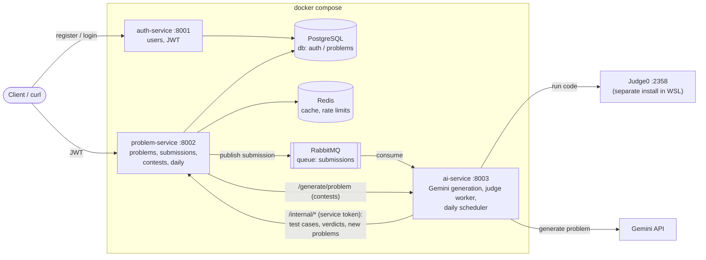

# CodeGenesis

A microservices coding platform. Users solve problems in Python, C++, Java or JavaScript, and their code runs in an isolated **Judge0** sandbox. An AI service uses **Gemini** to generate new problems, and every generated problem is checked in Judge0 before it is saved. It creates a **daily challenge** automatically every day and lets users start a **topic-based practice contest** with one request.

**Stack:** FastAPI · PostgreSQL · Redis · RabbitMQ · Docker Compose · Judge0 · Google Gemini (`google-genai`)

---

## Architecture



| Service | Port | Owns | Responsibilities |
|---|---|---|---|
| **auth-service** | 8001 | `auth` database: `users`, `auth_otps`, `auth_refresh_tokens` | Register with OTP verification, login, rotating refresh tokens, `/me`, roles (`user` / `admin`). It is the only service that **issues** JWTs. |
| **problem-service** | 8002 | `problems` database: `problems`, `submissions`, `contests`, `contest_problems`, `daily_problems` | Problem CRUD, submissions (queued to RabbitMQ), contests and scores, the daily challenge, Redis caching and rate limiting. |
| **ai-service** | 8003 | no database | Gemini problem generation with Judge0 validation, the RabbitMQ judge worker, and the APScheduler daily job. |

**Rules the services follow**
- Services never import each other's code. They talk only over **HTTP** or **RabbitMQ**.
- problem-service and ai-service only **verify** JWTs, using the shared `JWT_SECRET_KEY`. They never call auth-service to do it.
- Service-to-service endpoints live under `/internal/*` and require the `X-Service-Token` header.
- Untrusted code, whether a user's submission or an AI reference solution, **only ever runs inside Judge0**.
- There is one Postgres container, but each service has its own database and creates its own tables at startup from its `.sql` file. Every statement in those files is safe to run again.

### Request flows

**Submission:** a submission is judged in the background, outside the HTTP request.
1. `POST /submissions` saves the submission as `queued`, publishes it to the `submissions` queue and returns **202** with its id straight away.
2. The ai-service worker takes the message, sets the status to `running`, and fetches the problem's sample and hidden test cases.
3. It sends the code to Judge0 once per test case (`base64_encoded=true`, `wait=true`, with CPU, wall-time and memory limits) and stops at the first failure.
4. It compares stdout with the expected output after trimming whitespace, and works out the verdict, the maximum runtime and the maximum memory.
5. It sends the result back to problem-service over HTTP. Results go back over HTTP rather than a `results` queue, so problem-service doesn't need a consumer of its own.

Verdicts: `Accepted`, `Wrong Answer`, `Time Limit Exceeded`, `Runtime Error`, `Compilation Error`, `Internal Error`. `Internal Error` means the judge failed, not the user.

**AI problem generation:** a problem is saved only if its own reference solution passes all its test cases.
1. Gemini is called with `response_mime_type="application/json"` and a Pydantic `response_schema`. The reply must contain the title, description, formats, constraints, examples, hints, 8–12 test cases and a Python reference solution.
2. The reply is validated with Pydantic: required fields, 5–20 test cases, and length limits on every string.
3. The reference solution runs in Judge0 against every example and test case. Only if all of them are Accepted is the problem saved through problem-service. The reference solution itself is never stored.
4. If a step fails, it generates again, up to `AI_MAX_GENERATION_ATTEMPTS` (3) times, and then gives up. If Judge0 itself errors, it stops immediately so no Gemini calls are wasted.

**Daily challenge:** an APScheduler job inside ai-service runs once a day at `DAILY_JOB_HOUR_UTC`.
- It picks the day's topic from `DAILY_TOPICS` in rotation.
- It generates and validates one easy, one medium and one hard problem.
- It records them as that day's challenge, which `GET /api/v1/daily` then serves.
- Running it again is safe, because difficulties that already exist for that date are skipped.
- `POST /admin/run-daily` triggers the same job manually.

**Practice contest:** `POST /api/v1/contests/generate {topic, difficulty, num_questions}`
- It first reuses random existing problems with that topic and difficulty, which is instant.
- It asks ai-service to generate only the problems that are still missing.
- Submissions that include a `contest_id` count towards that contest's leaderboard. A user's score is the number of distinct problems they got Accepted.

**Redis**
- **Problem list:** cached for 60 seconds. Every create, update or delete bumps a version number, so a stale list is never served.
- **Daily challenge:** cached for 5 minutes.
- **Rate limits:** a fixed-window count per user. Submissions are limited per minute, and contests that need AI generation are limited per hour.
- **If Redis is down:** caching is skipped and the rate limits let requests through.

---

## Project layout

```
.
├── docker-compose.yml          # postgres, redis, rabbitmq + the 3 services (Judge0 is NOT in here)
├── .env.example                # copy to .env
├── infra/postgres-init.sql     # creates the `auth` and `problems` databases
├── scripts/e2e_submit.sh       # end-to-end submission check
├── auth-service/
│   ├── db.sql                  # auth tables (applied on startup)
│   ├── app/{main.py, api/, core/, db/, repositories/, schema/, services/}
│   └── test/
├── problem-service/
│   ├── problem.sql             # problem tables (applied on startup)
│   ├── sample_quey.sql         # seed problem for manual testing
│   ├── app/{main.py, api/, core/, db/, repositories/, schema/, services/}
│   └── test/
└── ai-service/
    ├── app/
    │   ├── services/prompts.py               # all Gemini prompts
    │   ├── services/gemini_client.py
    │   ├── services/generation_service.py    # generate -> validate -> retry
    │   ├── services/judge0_client.py         # language map + limits
    │   ├── services/judge_service.py         # verdict logic
    │   ├── services/submission_consumer.py   # RabbitMQ worker
    │   └── services/daily_job.py             # APScheduler job
    └── test/
```

Each service is its own FastAPI app with its own `Dockerfile` and `requirements.txt`. Database access uses raw SQL through SQLAlchemy `text()` and psycopg2.

---

## Running locally (WSL + Docker)

### 1. Judge0 (one-time, separate from this repo)

Judge0 runs as its own Docker Compose project on port `2358`. Containers reach it through `host.docker.internal:2358`; `docker-compose.yml` adds `extra_hosts: host.docker.internal:host-gateway` for this.

> **WSL2 note: Judge0 1.13.x needs cgroup v1.** On cgroup v2 (the WSL2 default), every run returns
> `Internal Error` with `No such file or directory @ rb_sysopen - /box/script.py`. To fix it:
> 1. Create `C:\Users\<you>\.wslconfig` containing:
>    ```ini
>    [wsl2]
>    kernelCommandLine = systemd.unified_cgroup_hierarchy=0
>    ```
> 2. In PowerShell, run `wsl --shutdown`, then reopen WSL.
> 3. `stat -fc %T /sys/fs/cgroup/` should now print `tmpfs`.
> 4. Restart Judge0.

Check that Judge0 can run code:
```bash
curl -s -X POST 'localhost:2358/submissions?base64_encoded=false&wait=true' -H 'Content-Type: application/json' \
  -d '{"source_code":"print(int(input())*2)","language_id":71,"stdin":"21"}'
# expect "stdout":"42\n" and "status":{"id":3,"description":"Accepted"}
```

### 2. Configure

```bash
cp .env.example .env
# then edit .env:
#   JWT_SECRET_KEY   long random string
#   SERVICE_TOKEN    python3 -c "import secrets; print(secrets.token_urlsafe(32))"
#   GEMINI_API_KEY   from https://aistudio.google.com/apikey
```

### 3. Start

```bash
docker compose up -d --build
docker compose ps        # all 6 containers "(healthy)" after ~30s
```

| What | URL |
|---|---|
| auth-service API docs | http://localhost:8001/docs |
| problem-service API docs | http://localhost:8002/docs |
| ai-service API docs | http://localhost:8003/docs |
| RabbitMQ management UI | http://localhost:15672 (guest / guest) |
| Postgres from the host | `localhost:5434` |
| Redis from the host | `localhost:6380` |

Postgres and Redis are published on **non-default host ports** (5434 and 6380), because Judge0's Redis already uses 6379 on the WSL host.

`/health` on each service reports its dependencies. ai-service also shows whether its submission consumer is running, whether Judge0 is reachable, and when the daily job next runs.

### 4. Run the tests

```bash
docker compose exec auth-service    pytest -q /service/test   # auth flow against real Postgres
docker compose exec problem-service pytest -q /service/test   # CRUD, submissions, contests, daily, cache, rate limits
docker compose exec ai-service      pytest -q /service/test   # verdict logic, Judge0 client, AI JSON validation (Judge0 + Gemini mocked)
```

---

## Environment variables

All configuration comes from `.env`. See `.env.example`.

| Variable | Used by | Default | Purpose |
|---|---|---|---|
| `POSTGRES_USER`, `POSTGRES_PASSWORD` | compose | postgres / password | Postgres credentials |
| `RABBITMQ_USER`, `RABBITMQ_PASSWORD` | compose | guest / guest | RabbitMQ credentials |
| `POSTGRESQL_URI` | auth, problem | set by compose | Base connection URI; each service appends its own database name |
| `JWT_SECRET_KEY` | all | – | Shared HS256 secret: auth signs tokens, the other services verify them |
| `JWT_ALGORITHM` | all | HS256 | |
| `JWT_ACCESS_TOKEN_EXPIRE_MINUTES` | auth | 15 | |
| `JWT_REFRESH_TOKEN_EXPIRE_DAYS` | auth | 7 | |
| `SERVICE_TOKEN` | problem, ai | – | `X-Service-Token` for `/internal/*` and ai-service calls |
| `REDIS_URL` | problem | set by compose | |
| `SUBMISSION_RATE_LIMIT_PER_MINUTE` | problem | 10 | Submissions per user per minute |
| `AI_GENERATION_RATE_LIMIT` | problem | 10 | Contests needing AI generation, per user per hour |
| `MAX_CODE_SIZE` | problem | 65536 | Maximum source code size in bytes |
| `JUDGE0_URL` | ai | http://host.docker.internal:2358 | |
| `JUDGE0_AUTH_TOKEN` | ai | empty | Sent as `X-Auth-Token` if your Judge0 requires one |
| `JUDGE0_TIMEOUT_SECONDS` | ai | 30 | HTTP timeout for one Judge0 call |
| `DEFAULT_TIME_LIMIT_MS` | ai | 2000 | CPU time limit per test case (wall-time limit is 3×) |
| `DEFAULT_MEMORY_LIMIT_MB` | ai | 256 | Memory limit per test case |
| `GEMINI_API_KEY` | ai | – | Google AI Studio key |
| `GEMINI_MODEL` | ai | gemini-3.5-flash | Any Gemini model that supports JSON output |
| `AI_MAX_GENERATION_ATTEMPTS` | ai | 3 | Generation retries before giving up |
| `DAILY_JOB_ENABLED` | ai | true | |
| `DAILY_JOB_HOUR_UTC` | ai | 0 | Hour (UTC) at which the daily job runs |
| `DAILY_TOPICS` | ai | arrays,strings,… | Comma-separated topics, rotated one per day |

Supported languages and their Judge0 ids are set in `ai-service/app/core/configs.py`: `python` 71, `cpp` 54, `java` 62 (the class must be named `Main`), `javascript` 63.

---

## API walkthrough (curl)

```bash
A=http://localhost:8001/api/v1/auth
P=http://localhost:8002/api/v1
AI=http://localhost:8003
```

### Auth

```bash
# Register -> 201. There is no email provider yet, so the OTP is written to the logs.
curl -s -X POST $A/register -H 'Content-Type: application/json' \
  -d '{"email":"me@example.com","password":"password123"}'
docker compose logs auth-service | grep "To: me@example.com"

# Verify -> 200
curl -s -X POST $A/verify-otp -H 'Content-Type: application/json' \
  -d '{"email":"me@example.com","otp":"123456"}'

# Login -> {access_token, refresh_token, token_type}
# Also accepts form data username/password, which Swagger's Authorize button uses.
curl -s -X POST $A/login -H 'Content-Type: application/json' \
  -d '{"email":"me@example.com","password":"password123"}'
TOKEN=<access_token>

curl -s $A/me -H "Authorization: Bearer $TOKEN"     # {"id":...,"email":...,"role":"user",...}

# Refresh -> new token pair. The old refresh token is revoked; reusing it returns 401.
curl -s -X POST $A/refresh-token -H 'Content-Type: application/json' -d '{"refresh_token":"<refresh_token>"}'
```

Make a user an admin, then **log in again** so the new role ends up in the token:
```bash
docker compose exec postgres psql -U postgres -d auth -c "UPDATE users SET role='admin' WHERE email='me@example.com';"
```

### Problems

```bash
curl -s "$P/problems?page=1"                       # public, cached
curl -s "$P/problems/1?language=python"            # public; hidden test cases are never returned

# Admin only: POST (201), PUT (200), DELETE (204)
curl -s -X POST $P/problems -H "Authorization: Bearer $TOKEN" -H 'Content-Type: application/json' -d '{
  "title": "Add Two Numbers", "difficulty": "easy",
  "description": "Read A and B, print A + B.",
  "constraints": ["-10^6 <= A, B <= 10^6"],
  "examples": [{"input": "2 3", "output": "5", "explanation": "2 + 3 = 5"}],
  "sample_testcases": [{"input": "1 2", "output": "3"}],
  "hidden_testcases": [{"input": "5 5", "output": "10"}, {"input": "-1 1", "output": "0"}],
  "topics": ["math"]
}'

# Or seed the sample problem directly:
docker compose exec -T postgres psql -U postgres -d problems -tA < problem-service/sample_quey.sql
```

### Submissions

```bash
# 202 straight away; judging happens in the background
curl -s -X POST $P/submissions -H "Authorization: Bearer $TOKEN" -H 'Content-Type: application/json' \
  -d '{"problem_id":1,"language":"python","source_code":"a,b=map(int,input().split())\nprint(a+b)"}'
# {"submission_id":"...","status":"queued"}

curl -s $P/submissions/<submission_id> -H "Authorization: Bearer $TOKEN"
# {"status":"completed","verdict":"Accepted","passed_count":6,"total_count":6,"runtime_ms":21,"memory_kb":3240,...}
```

One script runs the whole flow: register → admin → seed → Accepted, Wrong Answer, Compilation Error and TLE submissions.
```bash
bash scripts/e2e_submit.sh
```

### AI generation (admin JWT or service token)

```bash
# Takes about 10–60s: generate -> validate -> run the reference solution in Judge0 -> save
curl -s -X POST $AI/generate/problem -H "Authorization: Bearer $TOKEN" -H 'Content-Type: application/json' \
  -d '{"topic":"arrays","difficulty":"easy"}'
# 201 {"problem_id":17,"title":"...","topic":"arrays","difficulty":"easy","attempts":1}
# 502 with a reason per attempt if no valid problem was produced; 503 if GEMINI_API_KEY is missing

# Run the daily job now (it also runs automatically every day)
curl -s -X POST $AI/admin/run-daily -H "Authorization: Bearer $TOKEN"
# {"challenge_date":"...","topic":"hashing","results":[{"difficulty":"easy","status":"created","problem_id":18,...}, ...]}
```

### Daily challenge and contests

```bash
curl -s $P/daily          # today's easy/medium/hard problems (404 until the daily job has run)

# Instant practice contest (any logged-in user). Reuses existing problems first; AI generates the rest.
curl -s -X POST $P/contests/generate -H "Authorization: Bearer $TOKEN" -H 'Content-Type: application/json' \
  -d '{"topic":"math","difficulty":"easy","num_questions":3}'
# 201 {"contest_id":"...","problems":[...],"reused_count":2,"generated_count":1,...}

# Submit inside the contest so it counts towards the score
curl -s -X POST $P/submissions -H "Authorization: Bearer $TOKEN" -H 'Content-Type: application/json' \
  -d '{"problem_id":1,"language":"python","source_code":"...","contest_id":"<contest_id>"}'

curl -s $P/contests/<contest_id> -H "Authorization: Bearer $TOKEN"
# problems with your "solved" flags, "my_solved", and "leaderboard": [{"rank":1,"user_id":"...","solved":2}, ...]
```

---

## Troubleshooting

| Symptom | Cause / fix |
|---|---|
| Every verdict is `Internal Error … /box/script.py` | Judge0 on cgroup v2. See the WSL2 note above. |
| Submission stays `queued` | The ai-service consumer isn't running. Check `docker compose logs ai-service` and the Consumers count for `submissions` in the RabbitMQ UI. |
| `judge0_reachable: false` in ai-service `/health` | Judge0 is down. Run `curl localhost:2358/about` in WSL. |
| 401 on every request | `JWT_SECRET_KEY` is empty or changed after you logged in. Log in again. |
| 403 on admin endpoints | Your token was issued before your role changed. Log in again. |
| 401 or 503 on `/internal/*`, or contests can't reach ai-service | `SERVICE_TOKEN` is missing from `.env`. Add it and run `docker compose up -d`. |
| `/generate/problem` returns 503 | `GEMINI_API_KEY` is not set. |
| Gemini "model not found" | Your key can't use `GEMINI_MODEL`. Try `gemini-2.5-flash`. |
| 502 from `/generate/problem` | The model kept producing test cases its own solution fails. Retry; hard problems fail more often. |
| 429 | Rate limit. Wait for the `Retry-After` seconds. |
| Schema errors after pulling changes | `docker compose down -v && docker compose up -d --build` (this wipes the databases). |
| A port is already in use | Change the host side of `ports:` in `docker-compose.yml`. |

Logs: `docker compose logs -f auth-service problem-service ai-service`
